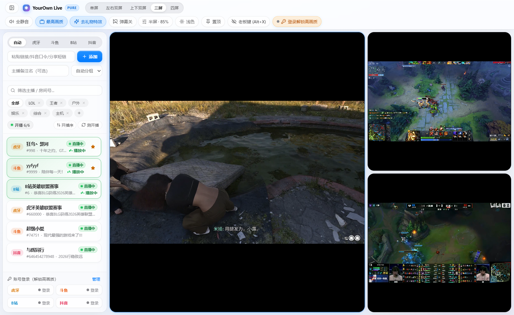
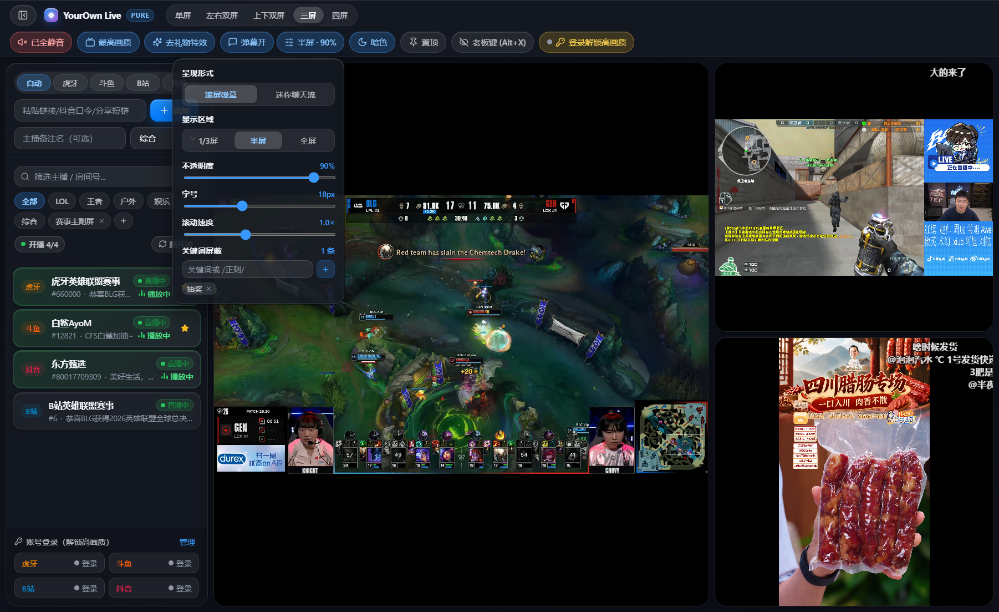
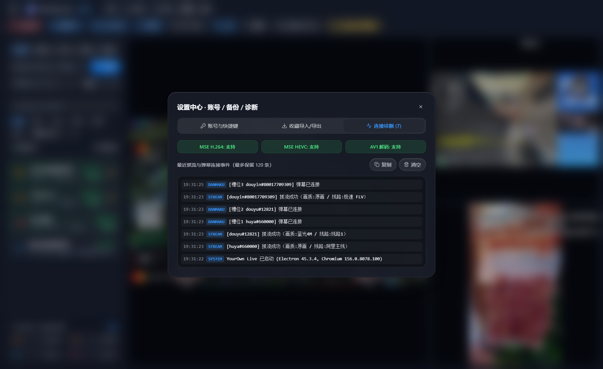

# YourOwn Live

> **打造属于你自己的跨平台直播观看平台** —— 自由订阅爱看的主播，还能**左屏看直播、右屏刷抖音 / B站 / 小红书**，告别各平台繁杂页面、贴片弹窗与 P2P 偷跑带宽，回归**纯净流、无广告、超低延迟**的一站式桌面摸鱼看播体验。


---

## ✨ 为什么做 YourOwn Live？

看直播本来是一件很轻松的事，但你是不是也遇到过这些烦恼：

- 喜欢的主播分散在**虎牙、斗鱼、B站、抖音**，每天要在几个 App 和浏览器标签页之间来回切；
- 打开一个直播间，满屏都是**开屏贴片广告、礼物特效、PK 横幅、抽奖弹窗、下载引导**，甚至后台还在偷偷跑 P2P 上传；
- 想同时看主舞台比赛 + 二路解说，浏览器开多个窗口不仅占内存，还容易卡顿和串音；
- 等开播、中场休息或看慢节奏直播时，想**一边看直播、一边刷抖音短视频 / B站 / 小红书**，来回切窗口不仅麻烦，声音还会打架。

**YourOwn Live** 把决定权交还给你：**只放你爱看的主播、只留最纯净的直播画面和弹幕，还能同屏一边刷抖音一边看直播**（独立音量与一键独听互不串音），真正打造属于你自己的桌面娱乐台。

---

## 📸 实机预览

**浅色毛玻璃 · 虎牙 / 斗鱼 / B站三屏同看（自动分组 & 开播排序）**


**暗色观影模式 · 2K 原画低延迟直连、原生 Canvas 弹幕与悬浮控制栏**


**设置中心 · 编解码硬解检测与实时连接诊断**


---

## 🚀 核心亮点

### 1. 纯净流直连 · 真正无广告
- **四平台极速直连拉流**：支持 **虎牙 / 斗鱼 / B站 / 抖音** 原生 FLV / HLS / fMP4 低延迟直连播放，无贴片广告、无推广弹窗、无礼物特效遮挡、无后台 P2P 偷跑。
- **自动最高画质与线路容灾**：支持进房自动切最高画质（最高支持 **2K / 4K / 原画 / 蓝光**，登录对应平台可解锁更高码率），可随时手动切换清晰度与 CDN 线路；单条线路波动时自动平滑重连并轮换备用 CDN。
- **网页净化模式兜底**：一键切换「直连 / 网页」模式（需要发弹幕或看录播时切回网页），网页模式下同样内置广告/P2P 域名拦截与元素净化。

### 2. 打造你的专属主播库
- **粘贴即看，智能识别**：直接粘贴直播间链接、房间号（如 `hy:660000`）、甚至抖音 App 分享口令与 `v.douyin.com` / `b23.tv` 短链，自动解析、自动去重、自动拉取真实主播名。
- **实时开播 & 双排序模式**：自动轮询所有收藏主播的开播/轮播/未开播状态，支持「**开播序**」与「**自定义拖拽排序**」一键切换，并支持「仅看开播」快速筛选。
- **自动分区归类 & 自由分组**：添加主播默认按直播分区自动归类，预置与自定义分组均支持双击重命名、删除前二次确认与一键恢复；确认时会显示受影响的主播数量，避免误删；支持主播改备注、置顶以及收藏列表 JSON 一键导出与去重导入。

### 3. 边看直播边刷抖音 · 自由网页同屏
- **左屏看直播，右屏刷抖音**：在双屏 / 三屏 / 四屏下，一侧纯净直连看虎牙 / 斗鱼 / B站 / 抖音直播，另一侧直接刷 **抖音短视频、B站、小红书、微博** 或任意网页；空窗格内置「边看边刷」快捷入口，点一下即刻开刷，搭配每屏独立静音与「一键独听（快捷键 `1`~`4`）」，看直播刷视频声音互不打架。
- **任意网址即收藏**：左侧平台胶囊支持「网页」模式，粘贴抖音 / B站 / 小红书 / 微博等**任意网址**（裸域名 `douyin.com`、`b23.tv` / `v.douyin.com` 短链均可识别）自动加入网页收藏并归入「网页」分组；而 `live.bilibili.com/房间号`、`live.douyin.com/房间号` 与虎牙 / 斗鱼链接依然走**纯净直连直播**，两类收藏共用备注、置顶、拖拽排序与 JSON 备份。
- **登录态与站内交互完整保留**：网页窗格复用应用内的 Cookie 分区，抖音 / B站登录一次即可同步关注与个性推荐流；不注入直播净化脚本，刷推荐流、评论区、搜索、点赞全部原生可用。
- **迷你浏览器顶栏 & 独立分屏适配**：内置后退 / 前进 / 刷新、可编辑地址栏（网址或关键词直达搜索）、一键系统浏览器打开；每个网页窗格独立隔离缩放，随分屏宽度**自适应缩放**（65%–100%，也可手动 35%–150% 微调），支持**桌面 / 手机版一键切换**，窄分屏刷抖音、B站、微博同样清晰不裁切。

### 4. 灵活多屏同看 & 丝滑交互
- **5 种分屏布局**：单屏 (`1×1`)、左右双屏 (`1×2`)、上下双屏 (`2×1`)、主副三屏 (`1+2`)、四分屏 (`2×2`) 自由切换。
- **拖拽调比例 & 临时单屏放大**：拖动分屏中缝即可自由调整主副屏占比（双击还原），双击标题栏或点击放大按钮即可临时全舞台看某一路（其余分屏不断流，按 `Esc` 瞬间恢复）。
- **独立音频控制**：每路分屏独立记忆音量，支持**滚轮调音量**、一键**独听**（自动静音其余分屏）与全局一键静音。
- **实用看播小工具**：悬浮毛玻璃控制栏（全屏静止自动隐藏）、画面等比完整 / 铺满去黑边切换、一键截图复制到剪贴板、窗口置顶、浅色 / 暗色观影 / 跟随系统三态外观。

### 5. 高性能原生弹幕
- **高 DPI `<canvas>` 弹幕引擎**：直连四平台官方 WebSocket 弹幕流（B 站自动复用已登录 Cookie），四屏同开依然流畅省资源。
- **双呈现模式**：支持传统**滚屏弹幕**与适合小分屏的**迷你聊天流**，自定义显示区域（1/3 屏 / 半屏 / 全屏）、不透明度、字号、滚动速度以及关键词/正则屏蔽（如 `/抽奖|口令/`）。

### 6. 摸鱼与稳定性细节
- **全局老板键 & 系统托盘**：默认 `Alt+X`（可自定义）一键静音并隐藏窗口，内置系统托盘支持快速唤出与静音控制。
- **原子持久化 & 连接诊断**：自动记忆窗口位置/尺寸与偏好设置；内置设置中心提供 H.264 / HEVC / AV1 硬解检测与实时抓流/弹幕连接诊断日志。

---

## ⌨️ 常用快捷键

| 快捷键 | 功能 |
| --- | --- |
| `1` ~ `4` | 切换对应分屏「独听」（自动静音其余画面） |
| `M` | 静音 / 取消静音当前焦点分屏 |
| `R` | 刷新当前焦点分屏直播流 |
| `Tab` | 在可见分屏间循环切换焦点 |
| `Space` | 暂停 / 继续播放当前直连画面（恢复自动追帧） |
| `F` / 双击画面 | 播放器全屏 / 退出全屏 |
| 鼠标滚轮 / `↑` `↓` | 微调当前直连分屏音量（5% 步进） |
| `Esc` | 退出全屏 / 还原临时放大分屏 / 关闭弹窗 |
| `Alt+X` | 全局老板键（一键静音并隐藏窗口，可在设置中修改） |

---

## 📦 下载安装（Windows）

前往 [Releases 页面](https://github.com/Gyf0402/yourown-live/releases) 直接下载最新打包版本，无需本地安装 Node / 编译：

- **`YourOwn-Live-*-win-x64-Setup.exe`**：Windows 安装版（支持自定义目录与桌面快捷方式）
- **`YourOwn-Live-*-win-x64-Portable.zip`**：Windows 绿色免安装版（解压后双击 `YourOwn Live.exe` 即可运行）

> 🔄 **内置检查更新 & 无损升级**：客户端启动后会自动静默检查新版本，也可在「设置中心 → 检查更新」手动检测并在应用内一键下载安装；收藏主播、分组、设置与四平台登录态均独立存储在 `%APPDATA%\yourown-live\`，覆盖安装或解压替换均不会丢失数据。

---

## 🛠️ 从源码运行与打包

### 环境要求
- Node.js >= 20
- pnpm >= 9
- Windows 10 / 11

### 安装与运行

```bash
# 1. 克隆仓库
git clone https://github.com/Gyf0402/yourown-live.git
cd yourown-live

# 2. 安装依赖
pnpm install

# 3. 开发模式运行（Vite 热重载 + Electron）
pnpm dev

# 4. 构建并启动
pnpm build
pnpm start
```

构建完成后，也可以直接双击项目根目录的 `启动YourOwnLive.bat` 快速启动。

---

## 🧩 技术栈

- **桌面端框架**：Electron 45（硬件解码 + MediaFoundation HEVC 支持 + 隔离沙箱签名 + 系统托盘）
- **前端界面**：React 19 + TypeScript + Vite 6 + Lucide Icons
- **流媒体解码**：`mpegts.js`（低延迟 HTTP-FLV）+ `hls.js`（HLS 容灾回退）
- **原生弹幕协议**：`ws`（斗鱼 STT / B站 WBI+Brotli / 虎牙 Tars / 抖音 Protobuf）+ 高 DPI Canvas 渲染

---

## 🤝 友情链接与社区支持

感谢开源社区与各位开发者的交流与反馈：

- **[LINUX DO](https://linux.do)** — 新的理想型社区（真诚、友善、团结、专业，感谢各位佬友的支持与建议）

---

## 📄 免责声明

本项目仅供个人学习、技术研究与本地纯净看播使用，不存储、不分发任何直播音视频内容，所有直播流与弹幕均直接来自对应官方平台接口。请遵守各直播平台用户协议与相关法律法规。

## 📜 License

本项目基于 [MIT License](./LICENSE) 开源，欢迎 Star、Issue 与 PR！
